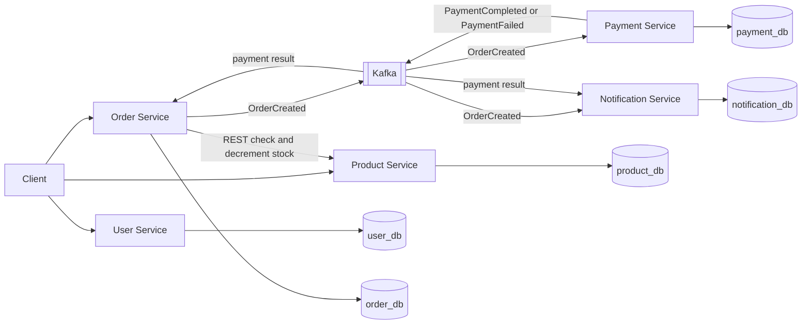
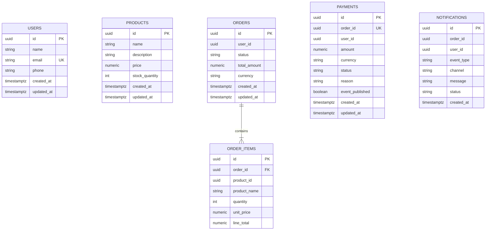

# Order Management System

Five Spring Boot services that take an order from stock reservation through simulated payment and notification. Each service has its own PostgreSQL database. Order, payment, and notification services talk through Apache Kafka. Swagger UI is enabled on every service.

## Architecture



Create order flow:

1. Order Service validates the request.
2. It calls Product Service `POST /api/products/{id}/stock/decrement` for each line. If a later line fails, earlier reservations are incremented back.
3. It stores the order as `CREATED` and publishes `OrderCreated`.
4. Payment Service consumes `OrderCreated`, simulates the payment, and publishes `PaymentCompleted` or `PaymentFailed`.
5. Order Service consumes that result and sets the order to `PAID` or `PAYMENT_FAILED`.
6. Notification Service consumes `OrderCreated`, `PaymentCompleted`, and `PaymentFailed`, simulates an email, and stores the notification status.

## Data model

Each box below lives in its own database. `user_id` and `product_id` on an order are logical references, not foreign keys across databases. `orders` and `order_items` are both in `order_db`.



Order status transitions:

| From | Allowed next status |
| --- | --- |
| `CREATED` | `PAID`, `PAYMENT_FAILED`, `CANCELLED` |
| `PAID` | `SHIPPED`, `CANCELLED` |
| `PAYMENT_FAILED` | `CANCELLED` |
| `SHIPPED`, `CANCELLED` | none |

Applying the status the order already has is a no-op, so a repeated payment event does not fail. Payment events only move an order to `PAID` or `PAYMENT_FAILED`. `CANCELLED` and `SHIPPED` are set with `PATCH /api/orders/{id}/status`.

Stock rules:

- Decrement quantity must be positive and no greater than the available stock.
- Stock never goes below zero. A shortfall returns HTTP 409.
- Increment restores stock and rejects a result above 1,000,000.
- An order line quantity must be from 1 to 1,000. Duplicate products in one order are rejected. An order has at most 20 lines.

Payment rule: amounts from 0.01 through 5000.00 complete. Zero, negative, missing, or larger amounts fail with a stored reason. The happy path below stays under that limit. A product priced above 5000.00 produces `PAYMENT_FAILED`.

Notification rule: a known order and user are stored as `SENT` on the `EMAIL` channel. A missing user id is stored as `FAILED`. The same order and event type are recorded once.

## Ports

| Service | Port | Swagger UI | Database |
| --- | --- | --- | --- |
| User | 8081 | http://localhost:8081/swagger-ui.html | `user_db` |
| Product | 8082 | http://localhost:8082/swagger-ui.html | `product_db` |
| Order | 8083 | http://localhost:8083/swagger-ui.html | `order_db` |
| Payment | 8084 | http://localhost:8084/swagger-ui.html | `payment_db` |
| Notification | 8085 | http://localhost:8085/swagger-ui.html | `notification_db` |
| PostgreSQL | 5432 |  | user `oms`, password `oms` |
| Kafka | 9092 |  | broker hostname `kafka` inside Compose |

OpenAPI JSON is at `/v3/api-docs` on each service. Health is at `/actuator/health`.

## Run with Docker Compose

Requirements: Docker with Compose v2.

```bash
docker compose up --build
```

The first build downloads Maven dependencies inside the images. Postgres creates the five databases from `docker/postgres/init.sql` the first time the volume is empty. When the health checks pass, run the happy path:

```bash
chmod +x scripts/happy-path.sh
./scripts/happy-path.sh
```

Stop and remove containers with `docker compose down`. Add `-v` to drop the Postgres volume.

## Happy path with curl

Create a user:

```bash
curl -s -X POST http://localhost:8081/api/users \
  -H 'Content-Type: application/json' \
  -d '{"name":"Ava Shah","email":"ava.shah@example.com","phone":"+1-555-0100"}'
```

Create a product with enough stock. The line total `12.50 * 2` is under the payment limit, so payment completes.

```bash
curl -s -X POST http://localhost:8082/api/products \
  -H 'Content-Type: application/json' \
  -d '{"name":"Notebook","description":"Hardcover lab notebook","price":12.50,"stockQuantity":25}'
```

Create the order. Replace the ids from the responses above. The response status is `CREATED`. Stock for the notebook drops by 2.

```bash
curl -s -X POST http://localhost:8083/api/orders \
  -H 'Content-Type: application/json' \
  -d '{"userId":"USER_ID","items":[{"productId":"PRODUCT_ID","quantity":2}]}'
```

Payment Service consumes `OrderCreated` and publishes `PaymentCompleted`. Order Service then sets the order to `PAID`. Poll until that happens:

```bash
curl -s http://localhost:8083/api/orders/ORDER_ID
```

Payment and notification follow on their own. Read them with the order id:

```bash
curl -s "http://localhost:8084/api/payments?orderId=ORDER_ID"
curl -s "http://localhost:8085/api/notifications?orderId=ORDER_ID"
```

You should see one payment with status `COMPLETED`, and two notifications (`ORDER_CREATED` and `PAYMENT_COMPLETED`) with status `SENT`.

Update a user or product with `PUT /api/users/{id}` and `PUT /api/products/{id}`. Ship or cancel an order:

```bash
curl -s -X PATCH http://localhost:8083/api/orders/ORDER_ID/status \
  -H 'Content-Type: application/json' \
  -d '{"status":"SHIPPED"}'
```

A product priced at `6000.00` with quantity 1 follows the same calls and ends as `PAYMENT_FAILED`, with a failed payment and a `PAYMENT_FAILED` notification.

Validation errors return 400, missing records return 404, stock conflicts and illegal status changes return 409, and a down dependency returns 503.

## Tests

Requirements: JDK 17 or newer and Maven 3.9 or newer. Tests do not need Postgres or Kafka.

```bash
mvn test
```

Covered behavior: stock decrement and increment rules, order creation validation and compensation, order totals, order status transitions, payment outcomes, and notification status and message text.

## Layout

```text
user-service/
product-service/
order-service/
payment-service/
notification-service/
docker/postgres/init.sql
docker-compose.yml
Dockerfile
scripts/happy-path.sh
```

Local defaults in each `application.yml` point at `localhost` Postgres and Kafka, with the ports above. Compose overrides the database URL, Kafka bootstrap server, and the product service URL.
